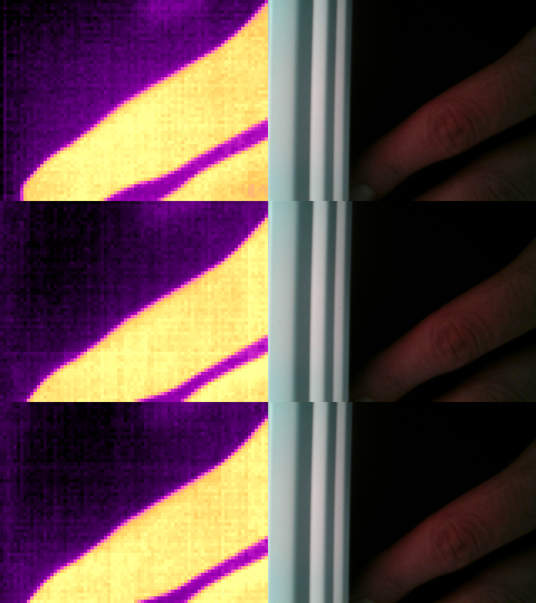

# flir-one-pc

Logiciel libre (Rust) pour utiliser une caméra thermique **FLIR One Gen 3**
(version Android / USB-C) sur un ordinateur : vidéo en direct et mesure de
température, sous Windows et Linux.

> Statut : testé sur Windows avec la caméra (via UsbDk) : flux, températures
> (constantes lues dans la caméra) et toutes les fonctions ci-dessous.
> Linux : testé le 11/10/2026 sur Ubuntu 24.04 et Debian avec la caméra
> (sans pilote, règle udev ci-dessous).
> macOS n'est pas pris en charge : le système bloque la requête USB qui
> démarre le flux d'images (détails dans [docs/architecture.md](docs/architecture.md)).



## Installation (sans compiler)

Les versions prêtes à l'emploi sont dans les **Releases** du dépôt GitHub.

- **Windows** : installer d'abord [UsbDk](https://github.com/daynix/UsbDk/releases)
  (voir Prérequis), redémarrer, puis lancer
  `flir-one-pc-vX.Y.Z-windows-x64.exe` (aucune installation, le fichier se
  lance directement).
- **Debian / Ubuntu** (Debian 12+, Ubuntu 22.04+) :
  `sudo apt install ./flir-one-pc_X.Y.Z-1_amd64.deb`. Le paquet ajoute
  « FLIR One PC » au menu des applications et la règle udev qui donne
  accès à la caméra sans root.

## Organisation

| crate          | rôle                                                         |
|----------------|--------------------------------------------------------------|
| `flir-proto`   | Découpage des trames, décodage thermique, radiométrie. Sans I/O, testable sans caméra. |
| `flir-usb`     | Ouverture de la caméra et lecture du flux USB (`rusb`/libusb, backend UsbDk sur Windows). |
| `flir-viewer`  | Application de bureau (egui) : image thermique en couleurs, image visible, min/max/centre, température au survol. |

Détails du protocole et feuille de route : [docs/architecture.md](docs/architecture.md).

## Prérequis

- Rust 1.95 ou plus récent (`rustup update`).
- **Windows** : installer [UsbDk](https://github.com/daynix/UsbDk/releases)
  (fichier `UsbDk_x.x.x_x64.msi`) puis redémarrer. Le logiciel l'utilise
  automatiquement. WinUSB (Zadig) et libusb-win32 **ne marchent pas** : ils
  ne transmettent pas la requête SET_INTERFACE dont la caméra a besoin pour
  envoyer ses trames. Si Zadig a déjà installé WinUSB sur la caméra, ce
  n'est pas gênant, UsbDk passe par-dessus.
- Un compilateur C est nécessaire (libusb est compilé avec le projet) :
  sous Windows, les « Build Tools » de Visual Studio, déjà requis par Rust.
- **Linux** : donner l'accès sans root avec une règle udev, par exemple
  `/etc/udev/rules.d/70-flir-one.rules` :
  `SUBSYSTEM=="usb", ATTRS{idVendor}=="09cb", ATTRS{idProduct}=="1996", MODE="0666"`

## Utilisation

```sh
# Premier test matériel : enregistre 10 trames dans ./captures
cargo run -p flir-usb --example dump -- captures 10

# Visionneuse
cargo run --release -p flir-viewer

# Tests
cargo test
```

Journal détaillé : `RUST_LOG=debug`. Pour travailler sans caméra :
`FLIR_REPLAY=captures cargo run --release -p flir-viewer` rejoue les trames
enregistrées par `dump`.

## Construire les paquets

```sh
# Paquet Debian (dans target/debian/)
cargo install cargo-deb
cargo deb -p flir-viewer

# Windows : l'exécutable, avec son icône, est target\release\flir-viewer.exe
cargo build --release -p flir-viewer
```

**Publier une version** : mettre à jour `version` dans `Cargo.toml`, puis
pousser un tag du même numéro (`git tag v0.1.0 && git push origin v0.1.0`).
GitHub Actions lance les tests, construit le `.exe` et le `.deb`, et les
attache à une Release.

## Visionneuse : fonctions

- **Écran d'attente** tant que la caméra n'est pas détectée : animation de
  branchement, conseils de dépannage, et liste des programmes qui peuvent
  bloquer la caméra (autre visionneuse, `dump`, logiciel FLIR) avec un
  bouton pour les fermer.
- **Statut** bien visible (recherche, connectée, calibration, figée) et
  **batterie** de la caméra avec son état de charge.
- **Déconnecter la caméra** : arrête le flux et libère la caméra pour la
  débrancher sans risque ; « Reconnecter » la reprend. La caméra est aussi
  libérée proprement à la fermeture du logiciel.

- **Point chaud** repéré en continu (réticule et température).
- **Points de mesure** : clic pour en poser (jusqu'à 9), clic droit pour
  retirer le plus proche.
- **Diagnostic par injection** : « Prendre la référence » carte hors
  tension, puis injecter la tension. L'image affiche alors l'écart en °C
  par rapport à la référence : seul ce qui chauffe ressort, même de
  quelques dixièmes de degré. Le **seuil** (écart affiché en noir, 0 °C en
  automatique) se règle ensuite vers le haut pour masquer les petits
  échauffements, ou vers le bas pour faire ressortir les plus faibles.
- **Réticule sur la photo** : le point chaud et les points de mesure sont
  reportés sur la photo. **Alignement en pointant** : cliquer un détail net
  (bout du doigt, pointe du fer) dans l'image thermique, puis le même
  détail dans la photo, ce qui règle la position ; un deuxième détail
  éloigné du premier règle aussi la taille. Réglages fins de taille et de
  décalage, superposition thermique réglable.
- **Mise en page adaptative** : images côte à côte sur une fenêtre large,
  l'une sous l'autre sur une fenêtre haute.
- **Moyenne anti-bruit** réglable, **échelle fixe**, image lissée.
- **Réglages de mesure** : émissivité, température réfléchie, **offset**.
  Les températures sont calées en continu sur la mesure que le capteur
  Lepton fait lui-même au centre de l'image (case « Référence du capteur »,
  cochée par défaut) : sans elle, les valeurs étaient trop hautes de 7 à 9 °C.
  Les réglages sont conservés d'une session à l'autre.
- **Figer** (barre d'espace).
- **Captures nommées** : le champ « Nom des captures » (par exemple
  « Dossier n°54 Xbox Series X ») sert à nommer les dossiers, sous la forme
  `2026-10-10 14h32m05s - Dossier n°54 Xbox Series X`. Ils sont rangés dans
  `captures/` à côté du logiciel, ou dans
  le dossier choisi avec
  « 📁 Choisir… » (« Ouvrir » l'affiche dans l'explorateur).
  - **📷 Image** : `image thermique.png` (avec réticule, points et
    températures), `photo.jpg` et `valeurs brutes.csv` (température de
    chaque pixel, s'ouvre dans Excel).
  - **⏺ Vidéo** : `vidéo thermique.avi` (annotée), `vidéo photo.avi` et
    `températures.csv` (temps, point chaud et points posés, image par
    image). Les vidéos se lisent avec VLC ou le lecteur Windows.

## Licence

MIT ou Apache-2.0, au choix ([LICENSE-MIT](LICENSE-MIT),
[LICENSE-APACHE](LICENSE-APACHE)). Le protocole a été documenté par la communauté
EEVblog (projet `flirone-v4l2`, GPL-2.0) ; ce code est une réécriture
indépendante qui n'en reprend pas le code.
